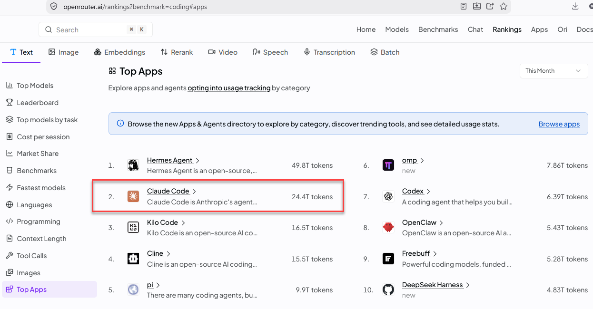
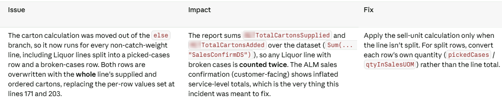
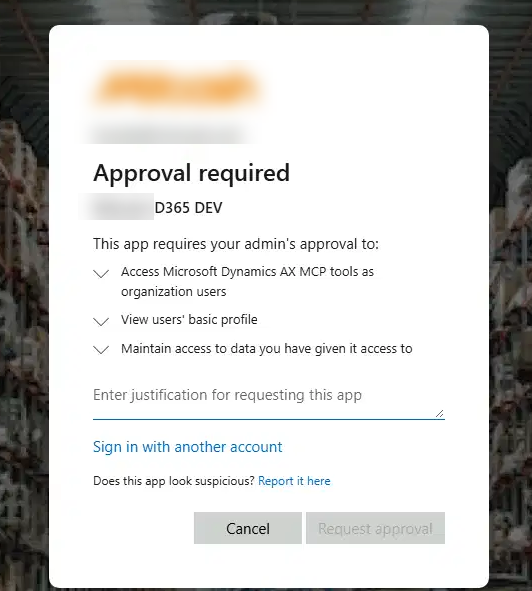

Over the last couple of weeks, I have been testing Claude Code on real X++ tasks, and I want to share my current view. It may be interesting for people who haven't worked with Claude Code before.

## Why Claude Code

Claude Code was one of the first AI coding harnesses, and similar tools from OpenAI and GitHub appeared after it. It is still one of the most popular: for example, among developers who use OpenRouter, Claude Code is one of the top coding apps ([OpenRouter rankings](https://openrouter.ai/rankings?benchmark=coding#apps)).

### Cost and limits

I use the $20 per month subscription, and it comes with two limits: a 5-hour limit and a weekly limit. In my experience, one 5-hour window uses about 12% of the weekly limit.

What does a 5-hour window mean in X++ terms? Imagine a task like importing sales orders from a JSON file with about 30 fields. To do it, Claude needs to analyse the JSON, create a staging table with proper types, write the logic to create sales orders, and create a form to view the staging data. Along the way, it checks how some custom fields are populated in the system and either proposes logic for them or asks questions, and you can ask it a couple of additional questions. In one 5-hour window, you get roughly half an hour of Claude actively thinking about a solution, and that is enough for a task like this.

The $20 plan is a good place to start, but there are more expensive plans.

## What Claude Code can do out of the box

Everything described in this section works without any MCP servers, add-ons or connectors. You just install Claude Code on your development VM.

### Understands your code

The latest Opus 5.5 model understands the D365FO structure quite well. Almost everything you would describe in a technical design document can be turned into working X++ code by Claude Code.

A typical request looks like this: "Implement this feature, use this model, and add new elements to this project". Before writing any code, Claude does its own research, like a developer would. It checks:

- Which naming conventions you use. For example, if your elements have a prefix, it automatically adds this prefix to new elements. You don't need to write any rules for this.
- How other code in your solution works with the same tables and fields.

Only after that does it produce the code.

### Compiles the code

A really great achievement of the current version is that Claude Code can figure out by itself how to compile X++ code. If the compile fails, it analyses the errors, fixes them and compiles again. So when you ask it to do something, you always get code that at least compiles.

Working out how to run the compiler each time costs time and tokens, so I created a small Claude Code skill, [d365-xpp-compile](https://github.com/TrudAX/d365fo-xpp-skills). It adds the changed objects to the Visual Studio project and compiles the project with `xppc.exe`. This improved the results a lot, and now I don't need to be involved in this step at all: the skill runs automatically after X++ code is changed and validates it.

### Queries the database

On cloud-hosted environments, Claude Code can query the local AxDB database using `sqlcmd` with Windows authentication. Again, no plugins are required.

This is very useful when analysing code. For example, if you have a select with table joins, Claude can check whether the relation is one-to-one or there are multiple records, and show you example records that explain why.

If you have read-only access to a Tier 2 database, Claude can also research problems based on real data. In a recent case, a sales invoice posting batch job was hanging, and I asked Claude to find out why. It checked the batch job and the class it runs, found that invoice posting works through the sales parm tables, and queried how many parm records were created during this batch run. That gave a clear picture of what was going on.

### Develop instead of configure

As a side effect of this, there may be cases where developing something is simpler than configuring it.

The current Advanced WMS has a huge number of settings. During a typical implementation, both developers and consultants struggle with these settings to get what the business really needs. On the other hand, Claude Code understands the Process Guide Framework, so it may be easier to develop a few new screens than to work out how to set up the system.

For example, someone in the MVP group recently mentioned [Swift WMS](https://www.aispire.com.au/swift-wms), a set of warehouse mobile screens for Basic Warehousing built on the Process Guide Framework. I don't know the details of this project, but I think we will see more solutions like it.

### Reviews code

Deployment in D365FO takes a lot of time. It is probably the biggest issue with X++ development right now, so finding problems before deployment is very important.

You can ask Claude to compare branches or review the difference. The prompt I use is simple: "Analyse this commit (or the commits for a day) and find logical issues". Because it can compile the code and query the data, the review is not just about style. Claude understands the business meaning of the code and queries.

In this example, you can see that Claude understands the business objects involved, not just the code.

### Works with Git

Many clients are moving from TFS to Git, and Git can be challenging if your mindset is still TFS. Claude Code can help with merges, resolving conflicts and managing branches.

### Uses your browser

Claude Code can also control the browser on your machine through the [Claude in Chrome](https://code.claude.com/docs/en/chrome) extension (it works with both Chrome and Edge). It uses your logged-in sessions, so it can see what your browser sees. For example, you can ask it to read a specification that is open in your browser, without any additional connectors.

### TRUDUtils

There is one exception where I still use my own tool. [TRUDUtils](https://github.com/TrudAX/TRUDUtilsD365) generates objects for well-known patterns, and in many cases this is much faster than describing the pattern to an LLM. In the future, I will probably replace it with a Claude Code skill. That is the obvious next step.

### A note on choosing the model and effort

Effort controls how much the model thinks and checks before giving an answer. At higher levels, it verifies its own work: for example, before using a field, it checks how other code in the system populates it. Higher effort means you wait longer and use more of your limit, but in X++ we don't write a lot of code, and getting working code is more important than the time spent. I use two options:

- **Opus 5.5** on **high** or **extra high** effort when the task is not clearly defined.
- **Sonnet 5.5** on **high** when the task is clear but there is a lot of data to analyse, for example comparing Git branches. It is much faster.

## Areas for future research

### Dynamics 365 ERP MCP server

Microsoft provides the Dynamics 365 ERP MCP server, which allows AI agents to work with D365FO through standard APIs, under the user's security roles. For reading data, SQL access already covers most of what I need. The interesting part is writing data. I don't have real experience of using MCP for this yet, so if you use it to create data, I would be very interested to hear your stories.

By default, only a few clients such as VS Code and Copilot Studio can connect, so the client ID you use must be added to the [Allowed MCP clients](https://learn.microsoft.com/en-us/dynamics365/fin-ops-core/dev-itpro/copilot/mcp/mcp-security#allowed-mcp-clients) form. There are three ways to connect Claude Code:

- **Own app registration (standard).** Ask your Entra admin to create a single-tenant public client app with the redirect URI `http://localhost:8765/callback` and the delegated Dynamics ERP API permission, then ask Claude Code to add the server. On the first login, you will see an approval request, which the admin approves in **Entra admin center > Enterprise apps > Admin consent requests**. If the admin grants consent when creating the app, you can skip this step.
- **Azure CLI token.** The [claude-code-d365fo-mcp](https://github.com/axpolik/claude-code-d365fo-mcp) project by axpolik uses the built-in Azure CLI client ID and your `az login` session, so no app registration or admin consent is needed. Fine for development and test environments.
- **Client ID and secret proxy.** If you already connect to the environment through OData with a client ID and secret, my [d365mcp-proxy](https://github.com/TrudAX/d365fo-xpp-skills/tree/main/notes/d365mcp-proxy) (written by Claude Code) uses the same credentials. It is undocumented but works. The proxy needs to be running, so it is less convenient, but it helps when getting the login approved takes time.

### Trace Parser agent

Another interesting project to investigate is Microsoft's [Trace Parser agent](https://github.com/microsoft/Dynamics-365-FastTrack-Implementation-Assets/tree/master/Agents/Implementation%20Agents/Trace%20Parser). It analyses D365FO performance traces through conversation: N+1 query patterns, slow SQL, blocking, X++ exceptions and call trees. It is built for Copilot Studio and is published as sample code, not a production tool. I haven't tried it yet, but it looks like a promising direction.

## Not solved yet: debugging

As part of X++ development, we spend a lot of time debugging: you need to see the stack trace, variable values and how the code flows. For this part, I don't know any AI solution yet. If you have found one, please share it.

## Summary

Claude Code with the latest models can analyse your code, follow your naming conventions, write and compile X++ code, query the database, review changes and help with Git, all without additional tooling.

The next steps to explore are the Dynamics 365 ERP MCP server for writing data, the Trace Parser agent for performance analysis, and replacing TRUDUtils with a skill. Debugging is still an open question.

I hope you found this post helpful. If you use Claude Code or the MCP server for X++ development, I would be interested to hear about your experience.
