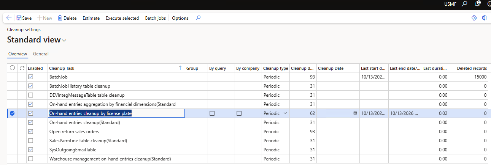

**InventSum** is one of the key tables for D365FO performance. It stores the on-hand inventory: one record for every combination of an item and its inventory dimensions (site, warehouse, location, inventory status, license plate, batch, and so on). Every inventory transaction updates it. On-hand calculations, availability checks, reservations and warehouse work all read it. For items enabled for warehouse management processing, the **WHSInventReserve** table stores the same on-hand data for each level of the reservation hierarchy.

Microsoft states that the performance of on-hand queries depends on the number of records in these tables. For this reason, it provides a periodic job, [Warehouse management on-hand entries cleanup](https://learn.microsoft.com/en-us/dynamics365/supply-chain/warehousing/onhand-cleanup), that deletes records where all quantities are zero. Other useful links:

- [InventSum table description (Common Data Model)](https://learn.microsoft.com/en-us/common-data-model/schema/core/operationscommon/tables/supplychain/inventory/transaction/inventsum)
- [Run an on-hand consistency check](https://learn.microsoft.com/en-us/dynamics365/supply-chain/inventory/on-hand-consistency-check). It explains how InventSum and WHSInventReserve are rebuilt from inventory transactions.
- [Reservations in Warehouse management](https://learn.microsoft.com/en-us/dynamics365/supply-chain/warehousing/reservations-in-warehouse-management). It describes the reservation hierarchy.

In practice, however, InventSum may keep growing even when the cleanup job runs every night, mostly because of closed records of old license plates. This post explains why the standard job can't delete them and provides a solution.

## The problem

The following queries show how many closed records have accumulated. Results like these are a reason to investigate whether the standard cleanup is leaving old license plate records behind:

| Query | Records |
| --- | ---: |
| `select count(*) from InventSum` | ~10.2m |
| `select count(*) from InventSum where Closed = 1` | ~10.1m |
| `select count(*) from InventSum where Closed = 1 and LicensePlateId <> ''` | ~10m |
| `select count(*) from WHSInventReserve` | ~8m |

In this example, almost all InventSum records are closed, and almost all closed records have a license plate. Each license plate usually has only a couple of records, and most of these license plates were emptied months or even years ago. They are no longer used, yet the nightly cleanup job may run for hours without deleting their on-hand records.

## Example

Let's take one old license plate. It was emptied in 2024 and never used again:

| Item | Warehouse | Location | License plate | Closed | Modified |
| --- | --- | --- | --- | --- | --- |
| ITEM-A | WH1 | A-01-01 | LP-000123 | Yes | 2024-09-25 |

Location A-01-01 is a normal picking location, so other license plates come and go there every day:

| Item | Warehouse | Location | License plate | Closed | Modified |
| --- | --- | --- | --- | --- | --- |
| ITEM-A | WH1 | A-01-01 | LP-009871 | Yes | 2026-10-09 |
| ITEM-A | WH1 | A-01-01 | LP-009902 | No | 2026-10-10 |
| ITEM-A | WH1 | A-01-01 | LP-009915 | No | 2026-10-11 |

Let's run the standard **Warehouse management on-hand entries cleanup** just for this license plate: set **License plate = LP-000123** in the filter and 30 in **Delete if not updated for this many days**. The job finishes almost instantly with the message:

**"0 on-hand entries were deleted."**

This isn't what we expect. The record is closed, all its quantities are zero, and it hasn't been updated for two years, so it should be deleted. Let's look at the standard code to see why this happens.

## Why the standard cleanup can't delete it

The job is implemented in the class `InventCleanupWHSInventSumService`. For every closed InventSum record that matches the filter, it calls two methods:

```csharp
// InventCleanupWHSInventSumService.runCleanup()
this.cleanUpWHSInventReserve(inventSum, inventDim, inventTable);

if (this.validateWHSInventReserveRecsDeleted(inventTable, inventDim)
    && this.cleanUpInventSum(inventSum, inventDim))
{
    cleanedUpInTransactionScope++;
}
```

First, `cleanUpWHSInventReserve()` deletes the empty WHSInventReserve records of the item. It doesn't delete records whose on-hand record was updated within the cleanup period, so recently used license plates are kept, which is correct:

```csharp
delete_from whsInventReserve
    where whsInventReserve.ItemId          == _inventTable.ItemId
       && whsInventReserve.AvailOrdered    == 0
       && whsInventReserve.AvailPhysical   == 0
       && whsInventReserve.ReservOrdered   == 0
       && whsInventReserve.ReservPhysical  == 0
       ...
    notexists join inventSum
        where inventSum.ItemId           == whsInventReserve.ItemId
           && inventSum.InventDimId      == whsInventReserve.InventDimId
           && inventSum.ModifiedDateTime >  modifiedBefore;
```

Then `validateWHSInventReserveRecsDeleted()` checks that no empty WHSInventReserve records are left. Only then is the InventSum record deleted:

```csharp
private boolean validateWHSInventReserveRecsDeleted(InventTable _inventTable, InventDim _inventDim)
{
    ...
    inventDimCriteria.data(_inventDim);
    inventDimCriteria.clearFieldsFromHierarchyList(
        WHSReservationHierarchyProvider::construct().
            getDimListBelowLocation(_inventTable, WHSReservationHierarchySortOrder::BottomUp));
    inventDimParm.initFromInventDim(inventDimCriteria);

    select firstonly forceselectorder RecId from whsInventReserve
        where whsInventReserve.ItemId == _inventTable.ItemId
           && (whsInventReserve.AvailOrdered   == 0
           && whsInventReserve.AvailPhysical   == 0
           && whsInventReserve.ReservOrdered   == 0
           && whsInventReserve.ReservPhysical  == 0
           ...)
           && #InventDimFieldsFilter(whsInventReserve, inventDimCriteria, inventDimParm)
        exists join resHierarchyElement
            where ...;

    return whsInventReserve.RecId == 0;
}
```

Note the **clearFieldsFromHierarchyList()** call. Before the check, the system clears **all dimensions below the location**. With a typical reservation hierarchy, the license plate is the lowest level, so it is below the location:

| Level | Dimension | Allow reservation on demand order |
| ---: | --- | --- |
| 1 | Site | Yes |
| 2 | Warehouse | Yes |
| 3 | Inventory status | Yes |
| 4 | Location | No |
| 5 | License plate | No |

So for LP-000123 the system doesn't check "are there any empty reservation records left for this license plate". Instead it checks "are there any empty reservation records left for ITEM-A at location A-01-01". For a busy location the answer is almost always yes. LP-009871 was emptied two days ago, so its empty WHSInventReserve record is still within the cleanup period and is correctly kept. Because of it, the old LP-000123 record isn't deleted either.

It's not clear why Microsoft implemented the check this way. Probably it covers some edge case for higher hierarchy levels, but it doesn't work when the license plate is the lowest level. The result is quite strange: if no license plate at a location was emptied recently, its old license plates are deleted, but at busy locations, where most of the records are, old license plates are kept forever. The job also checks the same records again every night, which may lead to it running for hours.

One possible option to make the standard job work is to swap the **License plate** and **Location** levels in the reservation hierarchy. However, this changes how reservations work for every item that uses the hierarchy, so a separate cleanup procedure is much safer.

## The solution: a custom cleanup class for license plates

This is the main part of this post: a custom cleanup class, [DEV_CleanupDataTask_InventSumLicensePlate](https://github.com/TrudAX/XppTools/blob/master/DEVTutorial/DEVCleanup/AxClass/DEV_CleanupDataTask_InventSumLicensePlate.xml), that deletes exactly the records the standard job can't delete.

The idea is simple. If **every** on-hand record of a license plate is closed and older than the cleanup period, the license plate isn't used any more, and all its InventSum and WHSInventReserve records can be deleted. All other records are left to the standard job.

The logical flow is the following:

1. **Select items where the license plate is the lowest level** of the reservation hierarchy. Items with, for example, a batch below the license plate stay with the standard cleanup.
2. **Select closed InventSum records** of these items that have a license plate and weren't updated during the cleanup period (62 days by default). This is done in every company.
3. **Skip license plates that are still in use.** If a license plate has any open on-hand record, or any record updated during the cleanup period (for any item), the whole license plate is skipped. To keep the main query fast, this condition is part of the main select, so SQL Server filters these license plates out and they are never read by the application server.
4. **Delete in small steps** (100 records by default). Each step is a set-based delete from WHSInventReserve and InventSum, joined to a temporary table by the clustered index of both tables. If any reservation record of a license plate still has a quantity, the step is skipped.
5. **Run in batch with the cleanup module settings**, such as the cleanup period, the maximum run time and the progress update.

The class also provides the standard **Estimate** function of the cleanup module. Run it before the cleanup to see how many records will be deleted in each company.

The first run may take several hours, depending on the size of your tables. The next runs delete only the license plates that have expired since then.

### Before you run it

The same note applies as for the standard job: once the license plate records are deleted, the **On-hand list** with closed transactions and the **Physical inventory by inventory dimension** report for past dates no longer show these license plates. Microsoft describes this in the [cleanup job documentation](https://learn.microsoft.com/en-us/dynamics365/supply-chain/warehousing/onhand-cleanup) and considers the performance gain more important. Choose the cleanup period with this in mind.

## Part of the cleanup module

This class is part of the cleanup module I described for AX2009/AX2012 in [Implementing Dynamics AX 2009/2012 database cleanup](https://denistrunin.com/ax2012-sqldelete/). The [module](https://github.com/TrudAX/XppTools/tree/master/DEVTutorial/DEVCleanup) has now been upgraded to D365FO:

- **Cleanup settings form.** One form lists all cleanup tasks with their period, the last run time and the number of deleted records. A task can be estimated, executed or scheduled in one batch job.
- **One base class.** A task implements two methods: `cleanup()` deletes the data and `estimate()` shows what will be deleted. The base class comment describes how to write each kind of task:
  - a simple X++ delete;
  - a call to a standard cleanup class in each company;
  - a user-defined query;
  - a direct SQL delete, using the SQL batch delete from the original AX2012 version.
- **New options:**
  - a maximum run time for a task;
  - how often the progress is updated;
  - task-specific settings that are visible only for the tasks that use them.
- **Example tasks** include BatchJobHistory, SysOutgoingEmailTable, SalesParmLine, integration messages, and the standard InventSum cleanups.



## Summary

The standard **Warehouse management on-hand entries cleanup** can't delete closed on-hand records of a license plate when the license plate is the lowest level of the reservation hierarchy and its location is still in use. In a typical warehouse management implementation these are almost all of the closed records in InventSum.

This issue still exists in the current version, **D365FO 10.0.49**, and may be resolved in a future version.

In any case, the described class provides a faster way to remove them. It works with license plates instead of locations, doesn't touch license plates that are still in use, deletes in short set-based steps by the clustered index, and can be stopped and restarted at any time.

As usual, validate all queries in your own environment before running them in production. If you have questions or suggestions, feel free to contact me.
