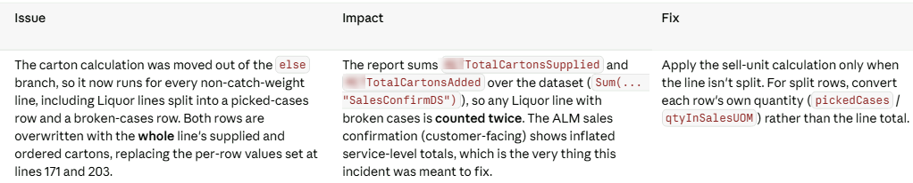
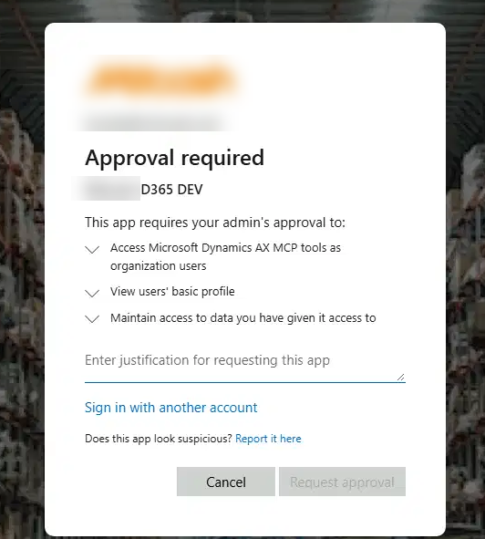
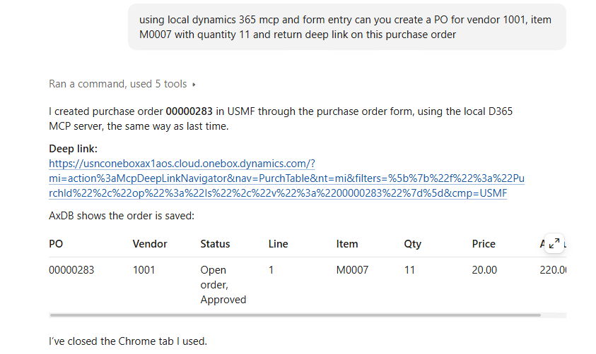
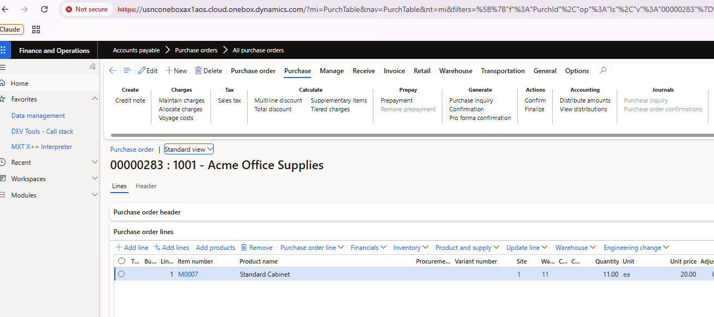
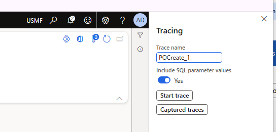
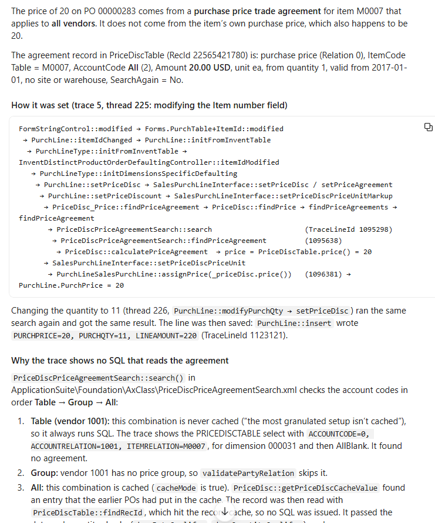

Over the last few weeks, I have been testing Claude Code on real X++ tasks. It can analyse existing code, write and compile changes, query the database, review commits and help with Git. Most of this works with a standard installation on a development VM.

With the Dynamics 365 ERP MCP server, Claude can also create and process documents in Tier2+ environments or on a local development VM with a [small fix](https://github.com/TrudAX/d365fo-xpp-skills/tree/main/notes/d365mcp-local-vhd). It can analyse a Trace Parser trace to explain how a field was populated, all the way back to the X++ code.

## What Claude Code can do out of the box

For the examples in this post, I used Claude Code on a Windows D365FO development VM, mainly with **Opus 5.5** on **high** effort. My hands-on experience is with classic local and cloud-hosted development VMs; this isn't a walkthrough of X++ development in a Unified Developer Environment (UDE).

Everything in this section works without a dedicated X++ MCP server. Claude needs access to the source code and the development tools on the VM.

### Understands your code

A typical request looks like this:

> Implement this feature, use this model, and add new elements to this project.

Before writing code, Claude does its own research, like a developer would. It checks which naming conventions you use and how other code in the solution works with the same tables and fields. For example, if your elements have a prefix, it usually picks up that prefix for new elements without a separate rule.

Almost everything you would describe in a technical design document can become a task for the agent. You still need to explain the requirement and review the proposed approach. For a larger change, I prefer to agree on the technical design before implementation.

### Compiles the code

Claude Code can work out how to compile X++ code. If the compile fails, it analyses the errors, fixes them and compiles again.

Working out how to run the compiler each time costs time and tokens, so I created a small skill, [d365-xpp-compile](https://github.com/TrudAX/d365fo-xpp-skills). It adds the changed objects to the Visual Studio project and compiles the project with `xppc.exe`. This improved the results a lot: in my workflow, the agent can handle the compile-and-fix loop without my involvement.

This gives it useful feedback while it works. Of course, a successful compile doesn't tell us whether the business scenario is correct. That is where tests, running the application and reviewing the result come in.

### Queries the database

On a classic development VM, Claude Code can query the local AxDB database using `sqlcmd` with Windows authentication. No database MCP server is required for this.

This is very useful when analysing code. If you have a select with table joins, Claude can check whether the relation is one-to-one or there are multiple records, and show you example records that explain why. What surprised me most was that it could combine reading the code with querying the related data without being told each individual step.

If you have approved read-only access to a Tier2 database, it can also research problems against that data. In a recent case, a sales invoice posting batch job was hanging. Claude checked the batch job and the class it runs, found that invoice posting works through the sales parm tables, and queried how many parm records were created during the batch run. That gave a clear picture of what was going on.

### Reviews code and works with Git

Deployment in D365FO takes a lot of time, so finding problems before deployment is very important.

You can ask Claude to compare branches or review a commit. The prompt I use is simple:

> Analyse this commit (or the commits for a day) and find logical issues.

Because it can read the surrounding code and query the data, the review can go beyond style. In this example, it identified a change in carton calculations that could double-count quantities in a sales confirmation report:

Many clients are moving from TFS to Git, and Git can be challenging if your mindset is still TFS. Claude Code can help with merges, resolving conflicts and managing branches. Give it your real work-item references and commit conventions: numbered subtasks in a conversation shouldn't accidentally become ticket references in commit messages.

### Uses your browser

Claude Code can control the browser through the [Claude in Chrome extension](https://code.claude.com/docs/en/chrome), which also works with Microsoft Edge. It shares the browser's logged-in sessions, so you can ask it to read a specification that is open in the browser without setting up a separate connector.

This browser connection is also how the local MCP example below authenticates to D365FO.

### Develop instead of configure?

As a side effect of this, there may be cases where developing something becomes simpler than configuring it.

Advanced WMS has a huge number of settings. During a typical implementation, both developers and consultants struggle with these settings to get what the business really needs. Claude Code understands the Process Guide Framework, so creating a few focused warehouse screens becomes a more realistic option.

For example, someone in the MVP group mentioned [Swift WMS](https://www.aispire.com.au/swift-wms), a set of warehouse mobile screens for Basic Warehousing built on the Process Guide Framework. I don't know the details of that project, but I think we will see more solutions like it.

It is still worth deciding whether a requirement should be handled by standard configuration, an integration or X++ before asking the agent to implement it. Easier development changes the cost of that decision; it doesn't remove the decision.

## Connecting to the Dynamics 365 ERP MCP server

Microsoft's built-in MCP server provides data tools, form tools and action tools. An agent can read and write data, work with forms and invoke exposed business logic. The form tools operate on server-side form state through APIs; they don't depend on finding a button in a screenshot. See [Microsoft's MCP overview](https://learn.microsoft.com/en-us/dynamics365/fin-ops-core/dev-itpro/copilot/copilot-mcp).

Microsoft documents support for **Tier2+ and Unified Developer Environments**. MCP can also be enabled on CHE and local VMs with this [small fix](https://github.com/TrudAX/d365fo-xpp-skills/tree/main/notes/d365mcp-local-vhd).

Let's look at how to set up MCP.

### UDE and Tier2+: use the standard connection

One question in the comments was whether there is official documentation specifically for Claude Code on UDE. The relevant Microsoft guidance is the general [Allowed MCP clients configuration](https://learn.microsoft.com/en-us/dynamics365/fin-ops-core/dev-itpro/copilot/mcp/mcp-security#allowed-mcp-clients). Claude Code is another MCP client: administrators register the application in Entra ID and add its client ID to the **Allowed MCP clients** form.

For my standard connection, I used a single-tenant public client app with a **Mobile and desktop applications** redirect URI of `http://localhost:8765/callback`, the delegated Dynamics ERP MCP permission and the required administrator consent. A public client doesn't need a client secret. Claude Code's [OAuth configuration](https://code.claude.com/docs/en/mcp#use-pre-configured-oauth-credentials) must match the app registration, including the callback port.

Microsoft's [VS Code setup guide](https://learn.microsoft.com/en-us/dynamics365/fin-ops-core/dev-itpro/copilot/mcp/mcp-vscode) explains the Microsoft client scenario. These documents establish environment support and the client-registration mechanism; they aren't a Claude Code-specific UDE walkthrough, and I haven't personally validated the complete UDE workflow.

I also tried the [Azure CLI token approach](https://github.com/axpolik/claude-code-d365fo-mcp) and a [client ID and secret proxy](https://github.com/TrudAX/d365fo-xpp-skills/tree/main/notes/d365mcp-proxy). In my experience, the standard app-registration connection has been the most stable for supported cloud environments. The alternatives have been more fragile, so I would start with the standard connection there.

## MCP on a local development VM

The lack of support for classic development VMs was a strange limitation from a developer's point of view. Developers are well placed to experiment with MCP, but couldn't use it on their own VMs.

Working with Claude Code, I created a small fix that enables the built-in `/mcp` endpoint in IIS and calls it from a signed-in D365 tab through Claude in Chrome.

This avoids a separate Entra app registration, client secret and tenant admin consent for the browser-based connection. Requests use the existing browser authentication and run with the signed-in user's D365FO security roles.

Use this on a development VM with a platform build that includes the MCP server; the [setup notes](https://github.com/TrudAX/d365fo-xpp-skills/tree/main/notes/d365mcp-local-vhd) describe the tested builds and version-specific requirements.

To install it, ask Claude Code on your VM:

> Set up the Dynamics 365 FinOps MCP using the following instruction: https://github.com/TrudAX/d365fo-xpp-skills/tree/main/notes/d365mcp-local-vhd

Then sign in to D365FO in the browser used by Claude in Chrome. The helper calls the built-in MCP endpoint from that page.

The same approach can also work with GitHub Copilot running locally in VS Code.

## Test: create a purchase order through the form

After installing the MCP, we can use the following prompt:

> Using local Dynamics 365 MCP and form entry, can you create a PO for vendor 1001, item M0007 with quantity 11 and return a deep link to this purchase order?

Claude opens the purchase order form, presses **New**, fills in the vendor, item and quantity, saves the order and returns a deep link. In this test, it created purchase order **00000283** in **USMF**, with a quantity of **11** and a unit price of **20**:

One useful developer scenario is combining this with access to a Tier2 environment: a consultant has created a document there, and you want to reproduce a similar case on your local VM. The agent can research the original document and create the local equivalent through the application.

Another example is asking it to post the invoice for an order. It can look at how previous orders were invoiced, choose parameters and run the operation. It works to a certain extent, and it looks quite amazing: you don't need to give it every individual step.

## Going further: let Claude read a trace

Now we have created a purchase order, we can ask a more interesting question: **why did the purchase price become 20?**

Enable a trace before running the scenario: **Settings > Trace**, with **Include SQL parameter values** enabled.

After the trace is finished and imported into Trace Parser, ask something like this:

> I traced the PO 00000283 creation process. You can use Trace Parser data from the AxTrace database (you may use a skill for this). The trace name is POCreate_1. Can you research how the PO line price of 20 was populated? What is the source of this information, and what code is used?

The `d365-xpp-trace-parser` skill gives Claude a procedure for reading the imported trace. It needs read access to the Trace Parser database and the matching X++ source.

In this example, Claude followed the call stack from the item control's `modified()` method through purchase-line initialisation and the price search to the line insert. It found that:

- The price came from a purchase trade agreement for item **M0007** that applied to **all vendors**.
- The agreement was read from the price cache, explaining why there was no SQL statement reading that agreement in the trace.
- The item's base purchase price was also **20**, but wasn't the source used for this line.

This is much more useful than simply finding a record with the same price. The trace provides the execution path and SQL parameter values, the source explains the cache and fallback logic, and the environment data lets us check the candidate agreement. These pieces need to agree before accepting the explanation.

Microsoft also has a [Trace Parser agent sample](https://github.com/microsoft/Dynamics-365-FastTrack-Implementation-Assets/tree/master/Agents/Implementation%20Agents/Trace%20Parser) for Copilot Studio. That is a separate project from the Claude Code skill used here; I haven't tested that sample myself.

## What still needs work

### Interactive debugging

Trace analysis doesn't replace stepping through X++ with breakpoints, inspecting variables and following the live call stack. I don't yet have that integrated into this workflow.

### Model, effort and cost

The model and the client running it both affect the result. My preference for less clearly defined X++ tasks has been Opus on high effort; for clearer tasks with a lot of data to compare, I have also used Sonnet on high. Higher effort gives the model more room to research and check its work, at the cost of time and usage.

For the original tests, I used a $20-per-month subscription with both a five-hour and a weekly usage limit. As a rough example, one usage window was enough for a task such as importing sales orders from a JSON file with around 30 fields: researching the data, creating a staging table, writing order-creation logic and adding a form. This is an observation from my workload, not a fixed amount of work guaranteed by a plan. Check the [current plans and limits](https://claude.com/pricing) when choosing a subscription.

### TRUDUtils

There is one exception where I still use my own tool. [TRUDUtilsD365](https://github.com/TrudAX/TRUDUtilsD365) generates objects for well-known patterns, and in many cases this is faster than describing the pattern to an LLM. Converting more of that knowledge into skills is an obvious next step.

## A note on d365fo-mcp-server

Several readers recommended [d365fo-mcp-server](https://github.com/dynamics365ninja/d365fo-mcp-server). In my experience, it isn't required for Claude Code with a capable model such as Opus 5.5. I see it as more useful for less capable models or harnesses. Microsoft's ERP MCP serves a different purpose: running business operations.

In [Filip Maňas's test](https://www.linkedin.com/pulse/why-your-x-ai-assistant-needs-mcp-server-filip-ma%C5%88as-yxzwf/), VS Code took 26 minutes without MCP and 6.5 minutes with it; Claude Code with Opus 5.5 took about 3 minutes without MCP in my test. He used Sonnet 5, so both the model and harness differed. My preference is to start with a capable model and harness.

## A more complete X++ development cycle

With these pieces in place, Claude Code can help through more of the development cycle:

1. Research the existing code, cross-references and relevant data.
2. Agree on the approach, implement the change and compile it.
3. Create and process test documents through the local MCP.
4. Capture a trace and link the observed behaviour back to X++ source.
5. Review the code and the resulting data before deployment.

The skills for compiling (`d365-xpp-compile`), cross-references (`d365-xpp-xref`) and trace analysis (`d365-xpp-trace-parser`) are in [TrudAX/d365fo-xpp-skills](https://github.com/TrudAX/d365fo-xpp-skills). To install them, ask Claude Code:

> Install the plugin from this repository: https://github.com/TrudAX/d365fo-xpp-skills

The biggest change for me is that the agent can connect these steps. It can read the implementation, check what is actually in the database, run a scenario through the application, and use the trace to explain the result.

So, welcome to the X++ AI era :)

If you have questions or experience with a similar workflow, feel free to share them in the comments.

---

The original LinkedIn articles and their discussions: [Using Claude Code for X++ development](https://www.linkedin.com/pulse/using-claude-code-x-development-denis-trunin-vxvmc/) and [Dynamics 365 Finance and Operations MCP on your local dev VM, plus trace analysis with Claude Code](https://www.linkedin.com/pulse/dynamics-365-finance-operations-mcp-your-local-dev-vm-denis-trunin-vkknc/).
